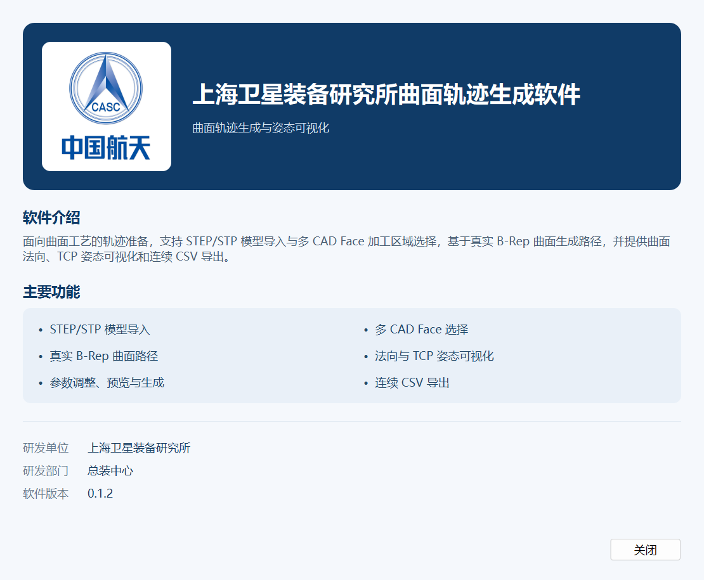

# 上海卫星装备研究所曲面轨迹生成软件

研发单位：**上海卫星装备研究所** · 研发部门：**总装中心**

基于 STEP/STP CAD 曲面生成加工轨迹，提供曲面选择、参数设置、轨迹预览、法向/TCP 姿态显示与连续 CSV 导出。
软件采用 C++17、Qt Widgets 和 Open CASCADE，直接使用真实 B-Rep 曲面计算路径。

## 安装

前往 [v0.1.2 Release](https://github.com/wingljj/RoboDK-s-curved-trajectory-generation-software/releases/tag/v0.1.2)
下载 Windows x64 Inno Setup 安装包，选择 Qt 5 或 Qt 6 版本即可。安装包包含所需运行库。

安装向导、应用图标及“帮助 → 关于”使用中国航天标志，标明上海卫星装备研究所总装中心。
开始菜单提供启动、软件介绍和卸载入口，可选桌面快捷方式。
详细步骤见 [安装说明](SurfacePathStudio/docs/installation.md)。

## 功能

- STEP/STP 导入和拖放，支持中文路径、装配层次、CAD Face 选择与高亮。
- 基于修剪 B-Rep 曲面生成平行截面路径，支持多曲面、孔洞、往复式/单向排列和路径参数调整。
- 三维预览与保存路径，默认显示加工轨迹、法向量、加工点与 TCP 坐标系。
- 完整 CSV 或 XYZ+Normal CSV 连续导出，相邻路径通过明确的直线 Transfer 连接。
- 七种 STEP 示例，路径项目树、显隐、重命名、删除、重算及撤销操作。

## 构建与验证

源码位于 [SurfacePathStudio](SurfacePathStudio)。构建要求：CMake 3.20+、C++17 编译器、
匹配架构/编译器的 Qt 5/6 与 OCCT SDK。依赖 SDK、构建目录和本机用户数据不存入 Git。
编译与 Inno Setup 打包命令见 [工程说明](SurfacePathStudio/README.md) 和
[安装构建说明](SurfacePathStudio/docs/installation.md)。

Qt 5 与 Qt 6 各通过 42 项 CTest，以及轨迹生成、显示、导出、拖入、关于窗口的桌面验收。
两份安装包已完成真实安装、独立启动与卸载验证；卸载保留另行导出的 CSV。
测试记录见 [验证说明](SurfacePathStudio/docs/validation.md)，Release 附带 SHA256、文件清单和安装验收 JSON。

第三方说明及许可文本见 [THIRD_PARTY_NOTICES](SurfacePathStudio/THIRD_PARTY_NOTICES.md)。
原始功能要求保存在 [AGENT.md](AGENT.md)。
