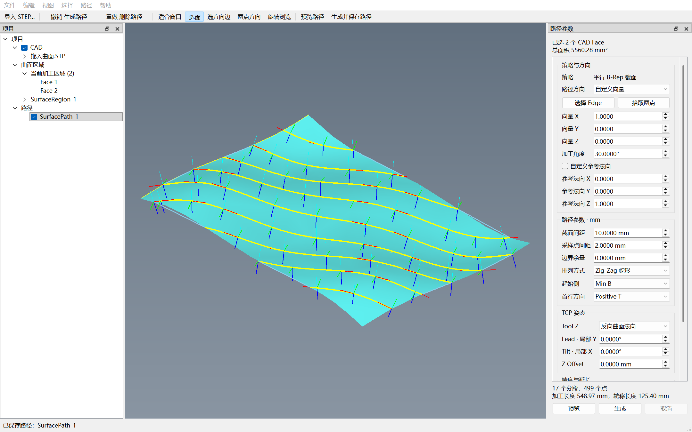

# 实际验证记录 — 2026-10-03 / 0.1.2

这份记录对应本机已编译并运行的 Windows x64 Release 软件。
Qt 5 与 Qt 6 分别构建；交付目录清除 Qt SDK 的 PATH 和插件环境后再次运行验收。

## 构建与交付

| 项目 | Qt 5 版本 | Qt 6 版本 |
|---|---|---|
| Qt | 5.15.0 / msvc2019_64 | 6.5.3 / msvc2019_64 |
| 编译器 | MSVC 14.29.30133，C++17 | MSVC 14.29.30133，C++17 |
| CAD 内核 | OCCT 7.6.0 静态 SDK | OCCT 7.6.0 静态 SDK |
| Viewer | 匹配官方源码补编 TKOpenGl | 匹配官方源码补编 TKOpenGl |
| CTest | **42 / 42 通过**，9.46 秒 | **42 / 42 通过**，10.58 秒 |
| 桌面验收 | **通过，进程退出码 0** | **通过，进程退出码 0** |
| 隔离环境交付验收 | **通过，进程退出码 0** | **通过，进程退出码 0** |
| 显示缩放实测 | Qt devicePixelRatio = 2 | Qt devicePixelRatio = 1.5 |
| 可执行文件 | `dist-branding-qt5/SurfacePathStudio.exe` | `dist-branding-qt6/SurfacePathStudio.exe` |

CMake 3.29.3、Ninja 1.12、Visual Studio 2019 x64。当前电脑没有 MSVC 2022，
因此 `msvc2022` 预设仅提供配置，未声称已经验证。其他电脑与其他版本 OCCT 也未实机验证。

两个交付目录均包含 Qt DLL、平台插件、MSVC x64 Release CRT、七个 STEP 模型、
README、第三方声明、许可文本和构建清单。清单记录可执行文件 SHA-256。
`dumpbin /DEPENDENTS` 显示直接依赖为对应版本 Qt、Windows 系统 DLL 与 MSVC CRT；
没有 ABB/RoboDK/Python/VTK/Open3D 依赖，OCCT 链入静态库。

## 42 项自动测试

| 分类 | 数量 | 验证内容 |
|---|---:|---|
| 示例 B-Rep | 1 | 七个程序化示例均为有效 OCCT 拓扑 |
| 几何与路径 | 24 | 平面、圆柱/整圆柱、修剪球面、起伏 BSpline、多 Face、孔洞、断开岛、任意刚性变换、反向 Face、真实 UV、边界余量、弧长/弦误差/法向细分、姿态/偏置、排列/起始侧、延长、异常参数、极端角度、取消/上限、接缝法向、连续 Transfer/延长连接/全路径四元数连续 |
| STEP/XCAF | 6 | mm、英寸、中文路径、嵌套装配名称/颜色/位置、无效文件、七种 STEP→路径→CSV 流程 |
| 导出 | 3 | 完整 CSV、分段简化 CSV、空路径/非有限数/流错误拒绝 |
| 后台控制器 | 5 | 主线程交付结果/进度、事件循环响应、取消、重复启动拒绝、销毁时取消并等待工作线程 |
| AIS 展示 | 3 | 默认加工点/法向/TCP 轴可见、整体显隐与分项组合、Transfer 不伪装为加工接触点 |

测试比较解析几何、OCCT 曲面值/导数和修剪 Face 分类；它们没有用显示网格作为几何真值。
新增接缝回归使用真实共边的平面和圆柱：两个允许的 2° 法向变化在删除接缝样点后
会合并成 4°，超出 3° 容差。该测试先失败，修正端点去重条件后通过。

## 桌面完整流程

验收应用导入两个共边 BSpline Face 的 STEP，再通过 **Qt 鼠标事件和真实 AIS 拾取** 检查：

1. 左键选 Face，Ctrl 增加/取消，Esc 清空，Undo 恢复区域。
2. CAD Edge 中点方向、两个曲面拾取点方向、相切 Face 扩选。
3. 加工角度 30°、Tool Z 反向曲面法向，后台生成并保持 GUI 定时器响应。
4. 默认开启加工点/法向/TCP，Preview 临时显示；触发真实 Generate QAction 保存到项目树；Delete/Undo/Redo；整体显隐同时控制法向和坐标轴。
5. 完整和简化 CSV 无空行，包含连接；真实 OCCT Viewer 图像输出。
6. DragEnter/DragMove/Drop 投递到视口/项目树/参数区，导入中文 `.STP`；拒绝多文件/目录/其他类型/网络 URL/计算中拖放；新模型清空旧路径。
7. 新产品名与模型导入后的标题、嵌入图标/原图 logo、实际打开“帮助 → 关于”、功能/研发部门/版本文本及关闭流程。

两个版本均得到 **9 个 Process 分段、8 个 Transfer 连接，共 499 个目标**，覆盖两个 Face。
其中原始加工点仍为 483 个，连接端点为 16 个；完整和简化 CSV 均为 1 行表头加 499 行数据，无空行。
该示例中重新投影验证的最大接触点误差为 **5.9050553 × 10⁻⁸ mm**，
所有接触点均位于其修剪 Face；TCP 坐标系正交、右手，Tool Z 与曲面法向相反。
此数值是该测试数据的结果，不是对任意输入模型的误差保证。
计算期间 Qt 定时器持续运行，具体心跳次数记录在每个版本的验收 JSON 中。

- [Qt 5 交付验收 JSON](validation-assets/qt5-desktop-smoke.json)
- [Qt 6 交付验收 JSON](validation-assets/qt6-desktop-smoke.json)
- [实际生成的完整 CSV](validation-assets/surface-path.csv)
- [简化 CSV](validation-assets/surface-path-xyz-normal.csv)




软件品牌定义见 [品牌与安装交付](branding-2026-10-03.md)，Inno Setup 复现步骤见 [安装与打包](installation.md)。

截图通过 `V3d_View::ToPixMap` 获取原生 OCCT RGBA 像素，再按实际 Widget 位置与 Qt 界面合成。
`QWidget::grab()` 单独使用不能包含 `WA_PaintOnScreen` 的原生 Viewer。

## 验收中修正的问题

- `Display(selectionMode=-1)` 后仅调用 `Activate` 不会将模型登记到 OCCT 7.6 选择器。
  现在先 `Load`，再激活 Face/Edge；真实点击回归通过。
- 独立高亮 Face 的再次三角化会改变显示误差并与已缓存模型产生深度瑕疵。
  现在复用显示模型的三角化，路径/姿态辅助线在独立显示层中保持可见。
- 导入后 Dock 布局改变视口尺寸；延迟一次 FitAll 并刷新窗口比例，避免初次显示裁切。
- 本机 MSVC 中文 `/showIncludes` 与代码页不一致会让 Ninja 漏掉头文件依赖。
  构建脚本现在检测实际编译器语言并提供匹配前缀；重新完整构建清除了旧缓存对象。
- 粗采样与反向 Face 接缝可能让连续性处理翻转正确 CAD 法向。
  采样/共边连接采用最多 89° 的法向角上限；反向 patch 保留独立分段。
- 法向、加工点和 TCP 轴原来默认关闭，旧 smoke 的手动开启掩盖了这个体验问题。
  当前检查原始默认 QAction 状态，再实际触发 Generate；显示回归验证隐藏会同时擦除全部所属 AIS。
- 简化导出原来跳过空走目标并插入空行；现在全部目标连续输出，保留 Transfer 顺序。

本次详细修复定义见 [生成显示、连续导出与 STEP 拖入修复](fixes-2026-10-03.md)。

## 当前交付范围

实现的是 Parallel B-Rep Section 首版。Step Over 为切片平面之间的欧氏距离，
不是 geodesic 等距；边界余量为三维最近距离的采样过滤。
加工路径保留分段，按顺序加入直线 Transfer；这些连接没有安全高度、避障或碰撞规划。
当前不包含品牌机器人程序或 IK。
曲面约束延长、项目文件持久化、完整参数 Undo 和独立 raw intersection/UV 调试层尚未实现。
当前 no-FreeType SDK 的三维文字取决于字体支持；Face ID 和层号在项目树/状态信息中仍可检查。

## 重现

从工程根目录运行：

```powershell
./scripts/Build.ps1 -RunTests -Deploy -DeployDirectory './dist-branding-qt6'
./scripts/SmokeTest.ps1 -Executable './dist-branding-qt6/SurfacePathStudio.exe' -IsolatedDistribution
./scripts/Build.ps1 -QtRoot 'D:/Software/QT/content/5.15.0/msvc2019_64' `
  -BuildName native-qt5 -RunTests -Deploy -DeployDirectory './dist-branding-qt5'
./scripts/SmokeTest.ps1 -Executable 'E:/surfacepathstudio-20261003/dist-branding-qt5/SurfacePathStudio.exe' `
  -OutputDirectory 'E:/surfacepathstudio-20261003/build/branding-qt5-smoke' -IsolatedDistribution
```

当前构建日志保存在 `build/branding-qt5-build.log` 与 `build/branding-qt6-build.log`；
完整桌面验收产物保存在 `build/branding-qt5-smoke` 及 `build/branding-qt6-smoke`。
